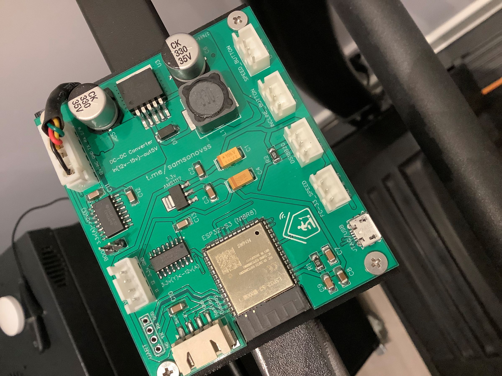

# PCB for ESPHome Treadmill FTMS

[English](#english) · [Русский](#русский)

**[Open project in OSHWLab / EasyEDA →](https://oshwlab.com/anton.samsonovs/project_cfwvyrhr)**

  
  

## English

A custom printed circuit board for the ESPHome Treadmill FTMS project, designed to simplify connecting the ESP32 and treadmill peripherals.

The board project is publicly available on **[OSHWLab / EasyEDA](https://oshwlab.com/anton.samsonovs/project_cfwvyrhr)**. Open that page to view the design in EasyEDA.

This PCB is optional: the firmware can also be used with a manually wired assembly following the project's [wiring documentation](../README.md).

Before manufacturing or connecting the board, check the pin assignments, connector orientation, supply voltages, and compatibility with your treadmill hardware. Do not assume that different treadmill motor controllers use the same connections.

## Русский

Собственная печатная плата проекта ESPHome Treadmill FTMS, упрощающая подключение ESP32 и периферии беговой дорожки.

Проект платы опубликован в открытом доступе на **[OSHWLab / EasyEDA](https://oshwlab.com/anton.samsonovs/project_cfwvyrhr)**. По ссылке можно открыть проект в EasyEDA.

Плата необязательна: прошивку можно использовать и с самостоятельной сборкой по [документации подключения](../README.ru.md).

Перед изготовлением или подключением проверьте назначение контактов, ориентацию разъёмов, напряжения питания и совместимость с оборудованием вашей дорожки. У разных плат управления двигателем подключения могут отличаться.
