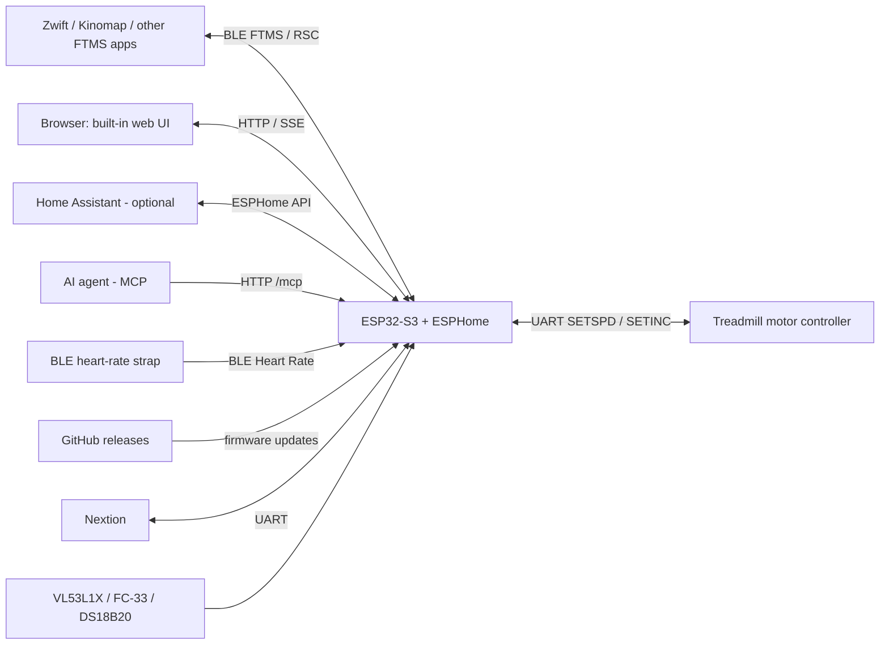
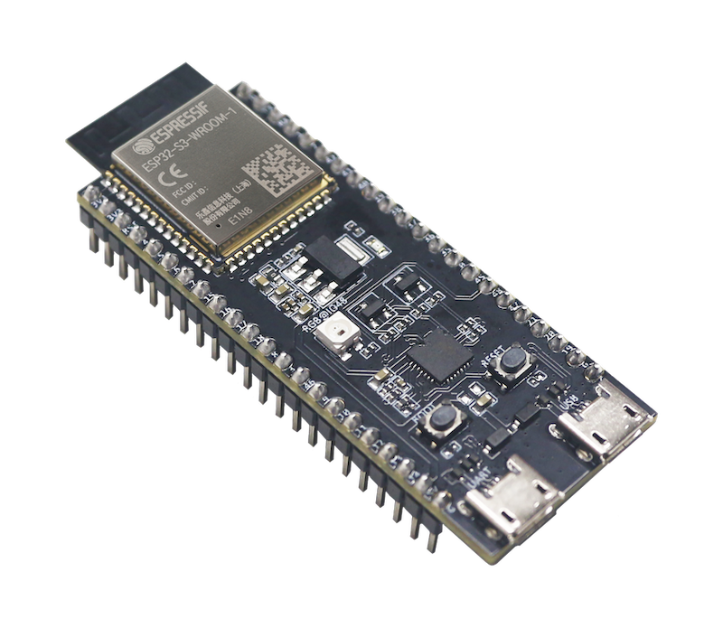
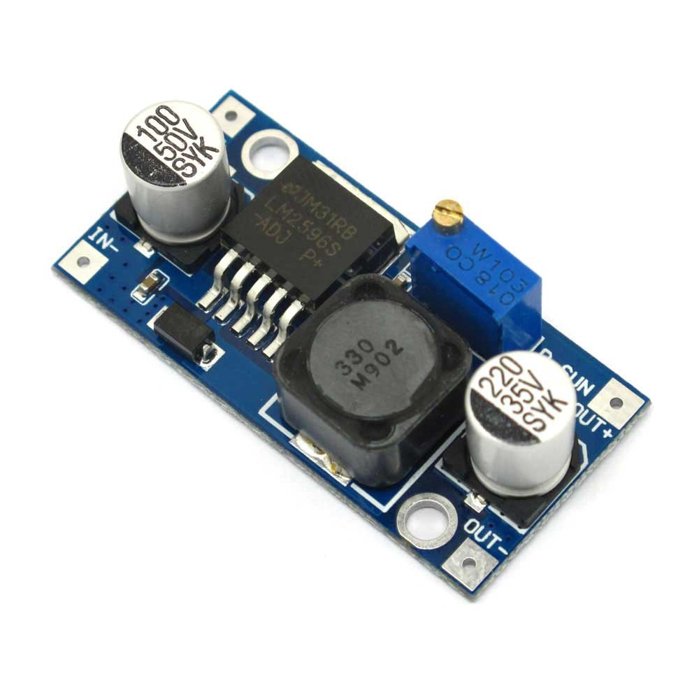
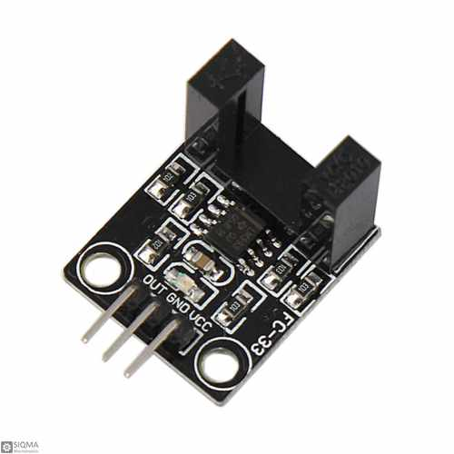
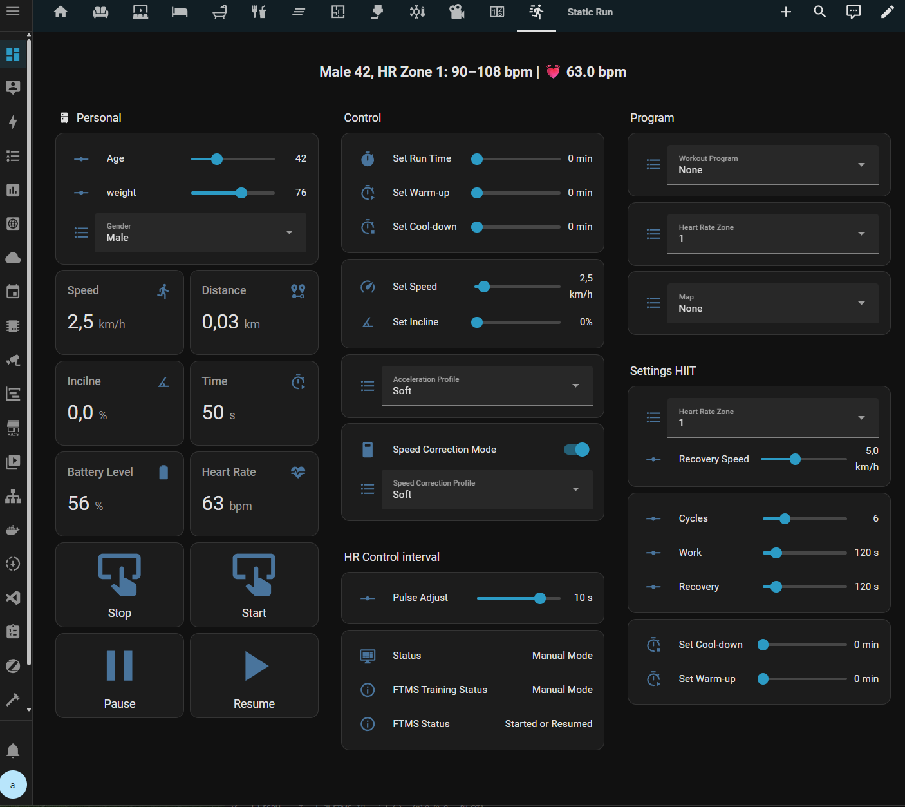
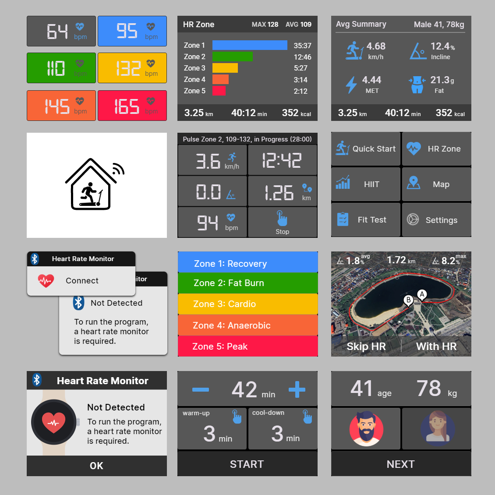
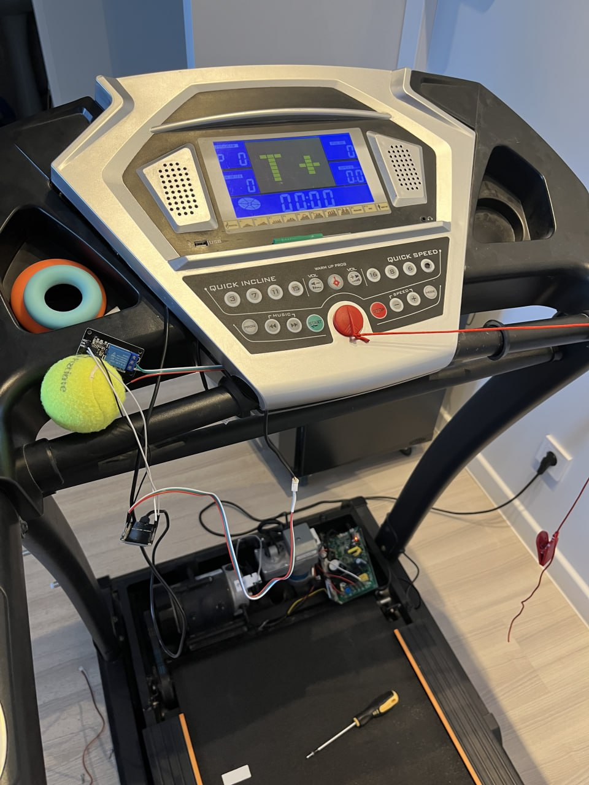
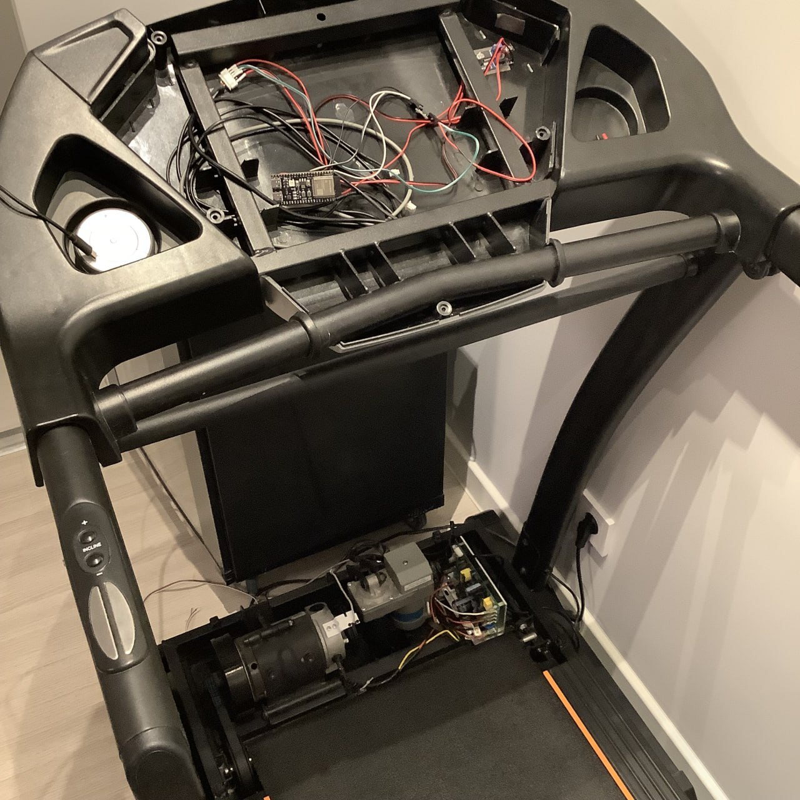
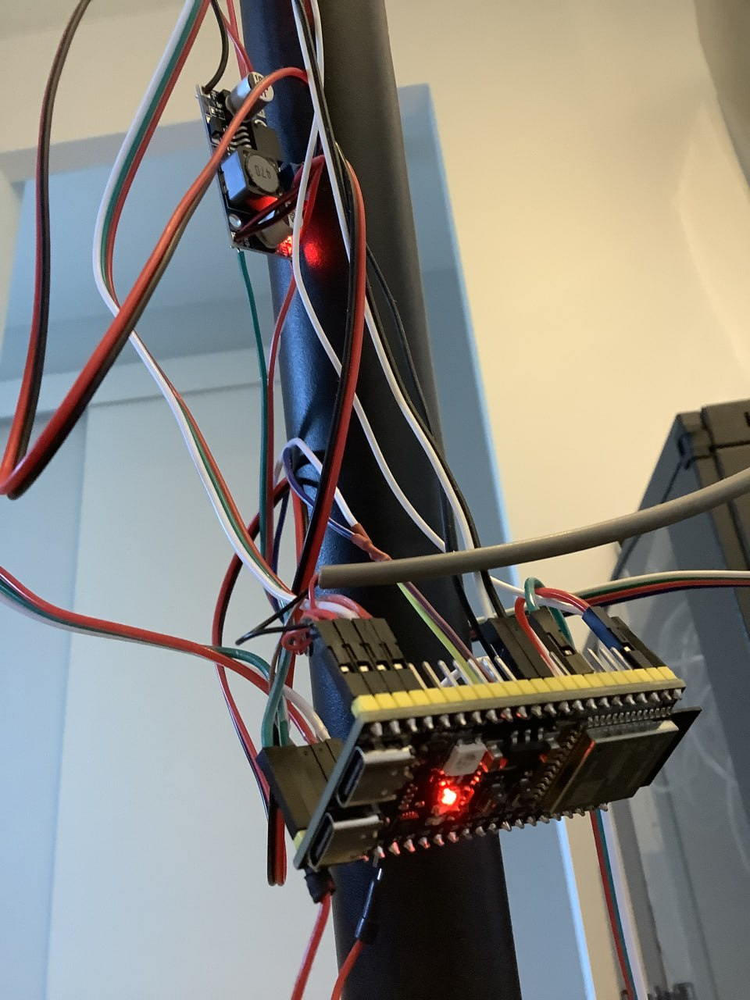

# Smart ESPHome Treadmill with FTMS and Native Zwift Incline Control

[Русская версия](README.ru.md) | [**Live demo**](https://samsonovss.github.io/ESPHome-Treadmill-FTMS/) | [Releases](https://github.com/samsonovss/ESPHome-Treadmill-FTMS/releases) | [HTTP API](docs/API.md) | [MCP](docs/MCP.md) | [Telegram community](https://t.me/TreadmillSmart)

Turn an older treadmill into a modern smart training machine. An ESP32-S3 with ESPHome replaces the original console, drives the lower motor board directly over UART and talks to Zwift and other fitness apps over Bluetooth [FTMS](docs/specs/FTMS_v1.0.pdf), without bridges or companion apps. Everything runs on the board itself: a full web interface, workout programs, heart-rate control, workout history with FIT export, and one-click firmware updates from GitHub. Home Assistant is supported but not required.

https://github.com/user-attachments/assets/f829769c-47f4-4251-8f99-d2f9a6cf358a

> [!TIP]
> **[Try the web interface in your browser](https://samsonovss.github.io/ESPHome-Treadmill-FTMS/)**: the same page the treadmill serves, running on simulated data.

## Highlights

- **Direct Bluetooth FTMS**: Zwift, Kinomap, FitShow, Kinni and other apps connect straight to the treadmill;
- **Native Zwift incline**: the route grade physically moves the deck;
- **Built-in web interface** at the treadmill's address: live workout, programs, history, progress, settings. RU/EN, light and dark themes, works offline;
- **Workout programs**: heart-rate zone, HIIT, fartlek, your own interval plans, routes drawn on a map or picked from the Zwift catalog;
- **Heart-rate control**: pair a BLE chest strap from the web page; the treadmill adjusts speed to keep you in the zone;
- **Workout history on the board**: every run is recorded to flash, with charts, a progress tab and **FIT export** for Strava and Garmin Connect;
- **One-click updates**: treadmill and display firmware update over Wi-Fi from GitHub releases;
- **AI agent access (MCP)**: Claude and other agents can read workouts and create programs; they cannot move the belt;
- **Nextion touchscreen**, **Home Assistant** integration, **laser ToF** user-position and safety zone, optical speed feedback, motor temperature monitoring;
- **Fully local**: no cloud, no account.

## Architecture



The ESP32-S3 is the central controller. It takes commands from the web page, the display, workout programs or fitness apps, sends them to the motor controller and publishes telemetry back to every client.

## Quick Start

> [!IMPORTANT]
> **The first install must be done over USB.** The firmware uses its own flash layout (a partition for workout history), so an older build cannot be converted over Wi-Fi. After this one USB flash, all later updates come over Wi-Fi with one click.

1. **Wire the board** (see [Hardware](#hardware) and [Wiring](#wiring)). Check your motor board's voltage levels first.
2. **Flash over USB.** Copy [`esphome/`](esphome/) into your ESPHome configuration directory, open `treadmill-public.yaml` in the ESPHome dashboard and choose *Install → Plug into this computer*. No secrets are needed for this build.
3. **Connect to Wi-Fi.** The board opens the **`Treadmill Setup`** hotspot. Join it, pick your home network and enter the password. It is stored on the board and survives updates.
4. **Open the treadmill's address** in a browser (shown in your router, or `http://treadmill.local`). Done: from now on, *Settings → System* shows new firmware versions and installs them over Wi-Fi.

Before the first run, test stopping, minimum speed and incline reset **without a person on the belt**.

Details: [installation guide](docs/INSTALL.md) · [building from source](docs/BUILD.md).

## Web Interface

The treadmill serves its own interface on port 80. The whole page is built into the firmware (gzip, ~210 KB) and needs no internet; only optional extras (map tiles, route building, update checks) go online.

| Tab | What it does |
|---|---|
| **Workout** | Live speed, incline, heart rate and zones on one chart; start/stop, manual control, route map and elevation ahead |
| **Programs** | Ready-made and your own programs: pulse zone, HIIT, fartlek, interval plans, map routes and the Zwift route catalog |
| **History** | Every saved workout with charts and a summary; download FIT or CSV; delete to a recoverable trash |
| **Progress** | Weekly/monthly/yearly volume, training load, intensity distribution, fitness trend, consistency |
| **Settings** | Your profile and HR zones, heart-rate strap pairing, treadmill tuning, display and firmware updates, AI agent connection |

Try it: **[live demo](https://samsonovss.github.io/ESPHome-Treadmill-FTMS/)**. More in the [web interface guide](docs/WEB_UI.md).

## Workout Modes

- manual control and **Free Run** (belt speed follows your position, laser ToF);
- **Pulse Zone**: the treadmill adjusts speed to hold your heart rate in the selected zone, with warm-up and cool-down;
- **HIIT**: work and recovery by time or by heart rate;
- **Fartlek**: random speed and incline surges within your limits, with presets;
- **Your own programs**: build interval plans in the web editor; they are saved on the board;
- **Routes**: incline follows an elevation profile, from a route drawn on a map or the [Zwift route catalog](route_profiles/);
- **native Zwift incline** control.

Treadmill behavior profiles: speed correction (`Soft`, `Precise`, `Aggressive`) and acceleration (`Soft`, `Normal`, `Fast`, `Technogym`).

## Supported Applications

| Feature | Zwift | Kinomap | FitShow | Kinni |
|---|---:|---:|---:|---:|
| Treadmill discovery over BLE | ✅ | ✅ | ✅ | ✅ |
| Speed, distance and heart-rate reporting | ✅ | ✅ | ✅ | ✅ |
| Start / pause / stop from the application | ➖ | ✅ | ✅ | ✅ |
| Target-speed and incline control from the application | ➖ | ✅ | ✅ | ✅ |
| Automatic route-grade incline control | ✅ | ✅ | ✅ | ✅ |
| Native Zwift route-grade incline control | ✅ | ➖ | ➖ | ➖ |

✅ tested and working; ➖ not applicable. Kinomap tested on Android and iOS. Other FTMS apps may use different characteristics and commands.

Standard FTMS covers all these apps. Native incline in Zwift additionally uses a Wahoo KICKR RUN compatibility profile: Zwift sends route grade through the Wahoo Run service, not the FTMS incline command.

### Zwift Automatic Incline

The current route grade comes from Zwift and is mapped to the treadmill's physical incline level. Settings: `Zwift Auto Incline`, `Treadmill Maximum Incline Level`, `Treadmill Real Grade At Maximum`, `Zwift Incline Intensity` (0-100%).

A treadmill level of `15` is not necessarily a real `15%` grade. Measure the actual rise and calibrate before enabling automatic incline. See [Zwift setup and incline calibration](docs/guides/ZWIFT.md).

<details>
  <summary><b>Zwift demonstration</b></summary>
  <p align="center">
    
  </p>
</details>

## Treadmill Compatibility

Developed for a treadmill with a PSA(xx)-family motor board accepting commands such as:

```text
[SETSPD:010]  -> 1.0 km/h
[SETINC:050]  -> incline level 5.0
```

Another treadmill can be adapted when its control interface is accessible, but having a UART does not make it compatible. Voltage levels, baud rate, packet format, commands, feedback and safe limits must be identified first. See the [UART parsing guide](docs/guides/UART_PARSING.md).

> [!IMPORTANT]
> Reverse-engineering the control protocol is usually the hardest part of adapting this project to another treadmill board.

## Hardware

Core components:

- ESP32-S3 with **16 MB flash and 8 MB octal PSRAM** (`N16R8` modules, e.g. ESP32-S3-DevKitC-1-N16R8). Boards with less flash or with quad PSRAM (`N16R2`, `N8R2`) will not run this firmware;
- treadmill with access to the lower motor controller interface;
- bidirectional logic-level converter;
- step-down power converter;
- Nextion `NX4880E043-011C`, 4.3-inch, 800 x 480 display;
- BLE heart-rate strap.

Optional: VL53L1X/TOF400C (Free Run, safety zone, display control), FC-33 (real-speed measurement), DS18B20 (motor temperature), 3D-printed enclosure and mounts.

<details>
  <summary><b>Component photos</b></summary>
  <p align="center">
    
    
    
  </p>
  <p align="center">
    
    
    
  </p>
</details>

## Wiring

<p align="center">
  
</p>

| Function | ESP32-S3 |
|---|---|
| Nextion RX/TX | GPIO1 / GPIO2 |
| Treadmill board TX/RX | GPIO17 / GPIO18 |
| I2C SDA/SCL | GPIO12 / GPIO11 |

Never feed 5 V or 12 V directly into ESP32-S3 GPIO pins.

## Integrations

- **Home Assistant**: the treadmill appears as an ESPHome device with all controls and sensors. The private build uses API encryption; see [building from source](docs/BUILD.md).
- **HTTP API**: live state over the standard ESPHome REST/SSE, plus workout archive and program endpoints. See the [API reference](docs/API.md) ([OpenAPI](docs/openapi.yaml)).
- **AI agents (MCP)**: `http://<treadmill>/mcp` lets Claude and other MCP clients list workouts, read summaries and save programs. See [MCP](docs/MCP.md).

> [!WARNING]
> The web interface, API and MCP have no authentication. Use them only on a trusted home network.

<details>
  <summary><b>Home Assistant, Nextion and the finished treadmill</b></summary>
  <p align="center">
    
  </p>
  <p align="center">
    
  </p>
  <p align="center">
    
    
    
  </p>
</details>

Videos: [control dashboard overview](https://youtube.com/shorts/wjRsA46usog) · [treadmill running](https://youtube.com/shorts/QqvJLKn4GOk).

## Repository Layout

- [`esphome/`](esphome/): firmware
  - `treadmill-public.yaml`: build used for releases (no secrets, Wi-Fi setup hotspot);
  - `treadmill.yaml`: private build with your own Wi-Fi/API/OTA secrets ([`secrets.example.yaml`](esphome/secrets.example.yaml));
  - [`packages/`](esphome/packages/): hardware, sensors, BLE/FTMS, programs, recorder, display, updates;
  - `*.h`: C++ parts (web page, recorder, programs, routes, MCP, motor);
  - [`components/`](esphome/components/): patched ESPHome components (BLE server for Zwift, Nextion);
- [`web-ui/`](web-ui/): web interface sources; `generate.py` builds `esphome/treadmill_dashboard.h`;
- [`nextion_display/`](nextion_display/): display source, HMI and compiled TFT;
- [`route_profiles/`](route_profiles/): Zwift running routes (map + elevation) for the route catalog;
- [`tools/`](tools/): release script;
- [`3d-models/`](3d-models/): printable enclosure and sensor mounts;
- [`PCB/`](PCB/): future PCB design materials;
- [`docs/`](docs/): guides, API reference, FTMS specification.

## Roadmap

- cadence measurement;
- feasibility study for a custom lower power board controlling the treadmill motor and incline.

Completed work is recorded in the [release notes](https://github.com/samsonovss/ESPHome-Treadmill-FTMS/releases).

## Author, Community and Support

Created by [Anton Samsonov](https://t.me/samsonovss). Discussion, builds and help: [Treadmill Smart](https://t.me/TreadmillSmart).

The project is developed in the author's free time and funded personally. If it has been useful to you, any contribution helps pay for components, prototypes, test equipment and documentation:

- PayPal: `samsonov@hotmail.com`
- BTC: `bc1q3cza0kasutzes4hfddxuclmd9ghn5v7zw2nr5c`
