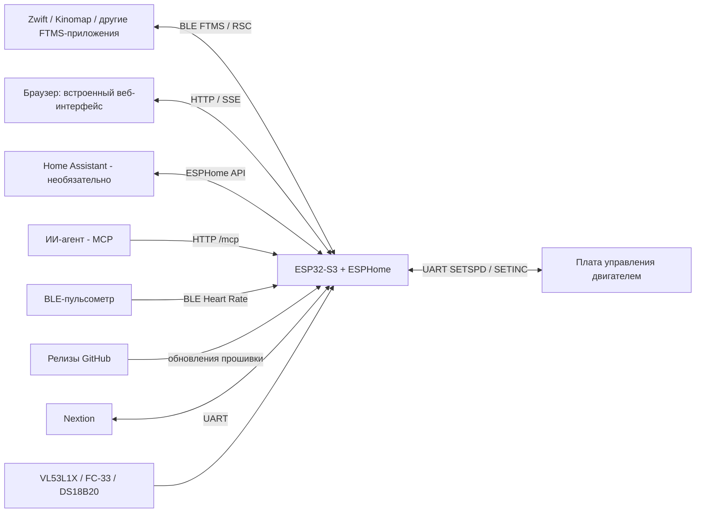

# Умная беговая дорожка на ESPHome с FTMS и нативным управлением наклоном из Zwift

[English version](README.md) | [**Живое демо**](https://samsonovss.github.io/ESPHome-Treadmill-FTMS/) | [Релизы](https://github.com/samsonovss/ESPHome-Treadmill-FTMS/releases) | [HTTP API](docs/API.ru.md) | [MCP](docs/MCP.ru.md) | [Telegram-сообщество](https://t.me/TreadmillSmart)

Превратите старую беговую дорожку в современный умный тренажёр. ESP32-S3 с ESPHome заменяет штатный бортовой компьютер, напрямую управляет нижней платой по UART и подключается к Zwift и другим фитнес-приложениям через Bluetooth [FTMS](docs/specs/FTMS_v1.0.pdf) без мостов и сторонних приложений. Всё работает на самой плате: полноценный веб-интерфейс, программы тренировок, управление по пульсу, история тренировок с экспортом в FIT и обновление прошивки с GitHub в одну кнопку. Home Assistant поддерживается, но не обязателен.

https://github.com/user-attachments/assets/f829769c-47f4-4251-8f99-d2f9a6cf358a

> [!TIP]
> **[Попробуйте веб-интерфейс прямо в браузере](https://samsonovss.github.io/ESPHome-Treadmill-FTMS/)**: та же страница, что открывается на дорожке, только на симулированных данных.

## Ключевые возможности

- **Прямой Bluetooth FTMS**: Zwift, Kinomap, FitShow, Kinni и другие приложения подключаются к дорожке напрямую;
- **Нативный наклон в Zwift**: уклон трассы физически поднимает полотно;
- **Встроенный веб-интерфейс** по адресу дорожки: тренировка в реальном времени, программы, история, прогресс, настройки. RU/EN, светлая и тёмная темы, работает без интернета;
- **Программы тренировок**: пульсовая зона, HIIT, фартлек, свои интервальные планы, маршруты, нарисованные на карте или выбранные из каталога Zwift;
- **Управление по пульсу**: нагрудный BLE-пульсометр подключается со страницы, дорожка сама меняет скорость, чтобы держать вас в зоне;
- **История тренировок на плате**: каждая тренировка сохраняется во флеш и после остановки сжимается (gzip), поэтому в архив на 7 МБ помещается примерно 100-230 часов бега, то есть несколько сотен тренировок. Графики, вкладка прогресса и **экспорт в FIT** для Strava и Garmin Connect ([что попадает в FIT-файл](docs/WEB_UI.ru.md#экспорт-в-fit));
- **Обновление в одну кнопку**: прошивка дорожки и дисплея обновляется по Wi-Fi из релизов GitHub;
- **Доступ для ИИ-агентов (MCP)**: Claude и другие агенты могут читать тренировки и создавать программы; управлять лентой они не могут;
- **Сенсорный дисплей Nextion**, интеграция с **Home Assistant**, **лазерный ToF-датчик** положения и безопасной зоны, оптическая обратная связь скорости, контроль температуры двигателя;
- **Полностью локально**: без облака и без аккаунта.

## Как это работает



ESP32-S3 — центральный контроллер. Он получает команды от веб-страницы, дисплея, программ тренировок или фитнес-приложений, передаёт их плате двигателя и отправляет телеметрию обратно всем клиентам.

## Быстрый старт

Компилировать ничего не нужно: в каждом релизе лежит готовая прошивка.

> [!IMPORTANT]
> **Первая прошивка — только по USB.** У прошивки своя разметка флеш-памяти (отдельный раздел под историю тренировок), поэтому старую сборку нельзя переделать по Wi-Fi. После одной прошивки по USB все следующие обновления идут по Wi-Fi одной кнопкой.

1. **Подключите плату** (см. [Оборудование](#оборудование) и [Подключение](#подключение)). Сначала проверьте уровни напряжения на плате двигателя.
2. **Прошейте по USB.** Подключите плату к компьютеру и откройте **[страницу установки](https://samsonovss.github.io/ESPHome-Treadmill-FTMS/install/)** в Chrome или Edge: *Connect and install*, одна кнопка. Или скачайте `treadmill-fw-<версия>.factory.bin` из [последнего релиза](https://github.com/samsonovss/ESPHome-Treadmill-FTMS/releases) и прошейте через [ESPHome Web](https://web.esphome.io).
3. **Подключите Wi-Fi.** Плата поднимет точку доступа **`Treadmill Setup`**. Подключитесь к ней, выберите домашнюю сеть и введите пароль. Он сохранится на плате и переживёт обновления.
4. **Откройте адрес дорожки** в браузере (он виден в роутере, или `http://treadmill.local`). Готово: дальше *Настройки → Система* показывает новые версии прошивки и ставит их по Wi-Fi.

Хотите менять код? Соберите прошивку сами из [`esphome/`](esphome/) в ESPHome: см. [сборку](docs/BUILD.ru.md).

Перед первым запуском проверьте остановку, минимальную скорость и сброс наклона **без человека на полотне**.

Подробнее: [установка](docs/INSTALL.ru.md) · [сборка из исходников](docs/BUILD.ru.md).

## Веб-интерфейс

Дорожка сама отдаёт интерфейс на порту 80. Страница целиком зашита в прошивку (gzip, ~210 КБ) и работает без интернета; в сеть ходят только необязательные функции (подложка карты, построение маршрута, проверка обновлений).

| Вкладка | Что делает |
|---|---|
| **Тренировка** | Скорость, наклон, пульс и зоны на одном графике; старт/стоп, ручное управление, карта маршрута и профиль высот впереди |
| **Программы** | Готовые и свои программы: пульсовая зона, HIIT, фартлек, интервальные планы, маршруты по карте и каталог трасс Zwift |
| **История** | Все сохранённые тренировки с графиками и итогами; скачивание FIT или CSV; удаление в корзину с восстановлением |
| **Прогресс** | Объём за неделю/месяц/год, нагрузка, распределение интенсивности, динамика формы, регулярность |
| **Настройки** | Профиль и пульсовые зоны, подключение пульсометра, настройка дорожки, обновление дисплея и прошивки, подключение ИИ-агента |

Попробуйте: **[живое демо](https://samsonovss.github.io/ESPHome-Treadmill-FTMS/)**. Подробнее в [описании интерфейса](docs/WEB_UI.ru.md).

## Режимы тренировок

- ручное управление и **Free Run** (скорость ленты следует за вашим положением, лазерный ToF);
- **Пульсовая зона**: дорожка меняет скорость, чтобы удерживать пульс в выбранной зоне, с разминкой и заминкой;
- **HIIT**: работа и отдых по времени или по пульсу;
- **Фартлек**: случайные ускорения и подъёмы в заданных пределах, есть пресеты;
- **Свои программы**: интервальные планы в веб-редакторе, сохраняются на плате;
- **Маршруты**: нарисуйте маршрут пробежки на карте прямо в веб-интерфейсе (для карты и профиля высот нужен интернет) или выберите из [каталога трасс Zwift](route_profiles/); маршруты сохраняются на плате, а наклон идёт по профилю высот;
- **нативный наклон из Zwift**.

Профили поведения дорожки: коррекция скорости (`Soft`, `Precise`, `Aggressive`) и разгон/торможение (`Soft`, `Normal`, `Fast`, `Technogym`).

## Поддерживаемые приложения

| Возможность | Zwift | Kinomap | FitShow | Kinni |
|---|---:|---:|---:|---:|
| Обнаружение дорожки по BLE | ✅ | ✅ | ✅ | ✅ |
| Передача скорости, дистанции и пульса | ✅ | ✅ | ✅ | ✅ |
| Старт / пауза / стоп из приложения | ➖ | ✅ | ✅ | ✅ |
| Управление скоростью и наклоном из приложения | ➖ | ✅ | ✅ | ✅ |
| Автоматический наклон по уклону трассы | ✅ | ✅ | ✅ | ✅ |
| Нативный наклон по уклону трассы Zwift | ✅ | ➖ | ➖ | ➖ |

✅ проверено и работает; ➖ не применимо. Kinomap проверен на Android и iOS. Другие FTMS-приложения могут использовать другие характеристики и команды.

Стандартный FTMS покрывает все эти приложения. Нативный наклон в Zwift дополнительно использует профиль совместимости Wahoo KICKR RUN: Zwift передаёт уклон через сервис Wahoo Run, а не через FTMS-команду наклона.

### Автоматический наклон в Zwift

Текущий уклон трассы приходит из Zwift и переводится в физический уровень наклона дорожки. Настройки: `Zwift Auto Incline`, `Treadmill Maximum Incline Level`, `Treadmill Real Grade At Maximum`, `Zwift Incline Intensity` (0–100%).

Уровень дорожки `15` — не обязательно реальные `15%` уклона. Измерьте фактический подъём и откалибруйте, прежде чем включать автоматический наклон. См. [настройку Zwift и калибровку наклона](docs/guides/ZWIFT.ru.md).

<details>
  <summary><b>Демонстрация Zwift</b></summary>
  <p align="center">
    
  </p>
</details>

## Совместимость с дорожками

Разработано для дорожки с платой двигателя семейства PSA(xx), которая принимает команды вида:

```text
[SETSPD:010]  -> 1.0 км/ч
[SETINC:050]  -> уровень наклона 5.0
```

Другую дорожку можно адаптировать, если есть доступ к её интерфейсу управления, но наличие UART ещё не значит совместимость. Сначала нужно определить уровни напряжения, скорость UART, формат пакетов, команды, обратную связь и безопасные пределы. См. [руководство по разбору UART](docs/guides/UART_PARSING.ru.md).

> [!IMPORTANT]
> Разбор протокола управления — обычно самая сложная часть адаптации проекта к другой плате.

## Оборудование

Основные компоненты:

- ESP32-S3 с **16 МБ флеш-памяти и 8 МБ octal PSRAM** (модули `N16R8`, например ESP32-S3-DevKitC-1-N16R8). На платах с меньшей флеш-памятью или quad PSRAM (`N16R2`, `N8R2`) прошивка не запустится;
- дорожка с доступом к интерфейсу нижней платы управления;
- двунаправленный преобразователь логических уровней;
- понижающий преобразователь питания;
- дисплей Nextion `NX4880E043-011C`, 4,3″, 800 x 480;
- BLE-пульсометр.

Дополнительно: VL53L1X/TOF400C (Free Run, безопасная зона, управление дисплеем), FC-33 (измерение реальной скорости), DS18B20 (температура двигателя), корпус и крепления для 3D-печати.

<details>
  <summary><b>Фото компонентов</b></summary>
  <p align="center">
    
    
    
  </p>
  <p align="center">
    
    
    
  </p>
</details>

## Подключение

<p align="center">
  
</p>

| Функция | ESP32-S3 |
|---|---|
| Nextion RX/TX | GPIO1 / GPIO2 |
| Плата дорожки TX/RX | GPIO17 / GPIO18 |
| I2C SDA/SCL | GPIO12 / GPIO11 |

Никогда не подавайте 5 В или 12 В напрямую на выводы ESP32-S3.

## Интеграции

- **Home Assistant**: дорожка появляется как устройство ESPHome со всеми кнопками и датчиками. Приватная сборка использует шифрование API, см. [сборку из исходников](docs/BUILD.ru.md).
- **HTTP API**: состояние в реальном времени через стандартные REST/SSE ESPHome, плюс архив тренировок и программы. См. [описание API](docs/API.ru.md) ([OpenAPI](docs/openapi.yaml)).
- **ИИ-агенты (MCP)**: `http://<дорожка>/mcp` позволяет Claude и другим MCP-клиентам смотреть список тренировок, читать итоги и сохранять программы. См. [MCP](docs/MCP.ru.md).

> [!WARNING]
> У веб-интерфейса, API и MCP нет авторизации. Используйте их только в доверенной домашней сети.

<details>
  <summary><b>Home Assistant, Nextion и готовая дорожка</b></summary>
  <p align="center">
    
  </p>
  <p align="center">
    
  </p>
  <p align="center">
    
    
    
  </p>
</details>

Видео: [обзор панели управления](https://youtube.com/shorts/wjRsA46usog) · [дорожка в работе](https://youtube.com/shorts/QqvJLKn4GOk).

## Структура репозитория

- [`esphome/`](esphome/): прошивка
  - `treadmill-public.yaml`: сборка для релизов (без секретов, точка доступа для настройки Wi-Fi);
  - `treadmill.yaml`: приватная сборка со своими секретами Wi-Fi/API/OTA ([`secrets.example.yaml`](esphome/secrets.example.yaml));
  - [`packages/`](esphome/packages/): оборудование, датчики, BLE/FTMS, программы, запись тренировок, дисплей, обновления;
  - `*.h`: части на C++ (веб-страница, запись тренировок, программы, маршруты, MCP, двигатель);
  - [`components/`](esphome/components/): исправленные компоненты ESPHome (BLE-сервер для Zwift, Nextion);
- [`web-ui/`](web-ui/): исходники веб-интерфейса; `generate.py` собирает `esphome/treadmill_dashboard.h`;
- [`nextion_display/`](nextion_display/): исходники дисплея, HMI и скомпилированный TFT;
- [`route_profiles/`](route_profiles/): беговые трассы Zwift (карта + высоты) для каталога маршрутов;
- [`tools/`](tools/): скрипт выпуска релизов;
- [`3d-models/`](3d-models/): корпус и крепления датчиков для печати;
- [`PCB/`](PCB/): материалы будущей печатной платы;
- [`docs/`](docs/): руководства, описание API, спецификация FTMS.

## Планы

- измерение каденса;
- проработка собственной силовой платы для управления двигателем и наклоном.

Выполненное записывается в [описания релизов](https://github.com/samsonovss/ESPHome-Treadmill-FTMS/releases).

## Автор, сообщество и поддержка

Автор — [Антон Самсонов](https://t.me/samsonovss). Обсуждение, сборки и помощь: [Treadmill Smart](https://t.me/TreadmillSmart).

Проект развивается в свободное время автора и на личные средства. Если он оказался вам полезен, любая поддержка поможет оплатить компоненты, прототипы, тестовое оборудование и документацию:

- PayPal: `samsonov@hotmail.com`
- BTC: `bc1q3cza0kasutzes4hfddxuclmd9ghn5v7zw2nr5c`
